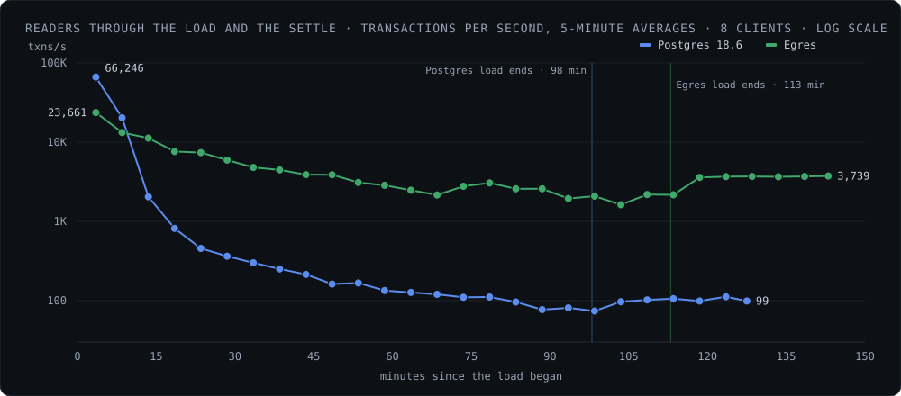
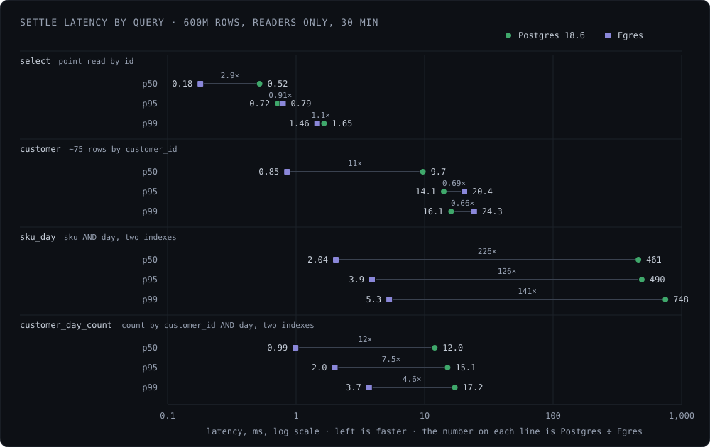

Egres against Postgres 18 on one machine: 600 million rows in one table with four single-column indexes, loaded from scratch under a 64 GiB memory cap, with readers running throughout and for 30 minutes after. This page is the source for every benchmark number quoted elsewhere on this site and in the blog.

:::note[What this measures]
One node: the storage engine and the SQL executor. Nothing here measures replication, branching, tenancy or distributed compaction. The readers are 8 closed-loop clients, so per-query rates are not capacity; latency at a fixed arrival rate was not measured.
:::

## The short version

| | Postgres 18.6 | Egres |
|---|---|---|
| **Settle: 600M rows loaded, readers only, 30 minutes** | | |
| Two-index query (`sku AND day`), p95 | 490 ms | **3.9 ms** |
| Other three queries, mean latency (geometric mean) | 3.5 ms | **1.3 ms** (2.8×) |
| Reader transactions/s | 97 | **3,563** |
| **During the load, with inserts running** | | |
| Two-index query p95 in the last 15 minutes | 1,597 ms | **11.3 ms** |
| Reader transactions/s, first 15 minutes | **29,451** | 16,811 |
| Reader transactions/s, last slice of the load | 79 | **2,083** |
| **Load and disk** | | |
| Load rate | **101,654 rows/s** | 88,259 rows/s |
| Data directory at the end of the load, against 579 GiB of raw data | 693 GiB (1.20× raw) | **376 GiB** (0.65× raw) |
| Bytes written over the run (write amplification) | 3.0 TiB (5.2×) | **2.3 TiB** (4.0×) |

In one paragraph: Postgres loads 15% faster. Egres uses 46% less disk and writes 23% fewer bytes. While the table fits in memory, Postgres serves nearly twice the readers. Once it does not, a query on two indexed columns settles at 490 ms p95 in Postgres and 4 ms in Egres, because Egres intersects the two index posting lists where Postgres fetches about 3,000 heap pages. With inserts still running the same query reaches 1.6 s in Postgres. That one query takes Postgres's readers from 29,000 a second to under 100. On the other three queries Egres is about 2.8× faster on mean latency, but not on every percentile: Postgres keeps the better p95 on the point read and on the customer lookup.

<figure class="fig">
  
  <figcaption>Reader throughput through the load and the 30-minute settle after it, in 5-minute averages of the harness's per-minute counts, on a log scale. Both start high while the table is small and cached. Postgres is below 1,000 transactions a second by minute 20 and below 100 by the end of its load at 98 minutes, and stays there once the inserts stop. Egres declines to about 2,000 by the end of its load at 113 minutes, then climbs to about 3,700 in the settle as compaction finishes. The 15-minute averages are in the table under Queries.</figcaption>
</figure>

## Setup

- **Machine:** Ryzen 9 5950X (16 cores, 32 threads), 121 GiB RAM. Data on a Samsung 980 PRO NVMe, WAL on a Samsung 860 PRO SATA SSD, run output on a second SATA SSD.
- **Disks before each run:** mostly empty, and `fstrim` run on each of them before the server started, so neither system paid for a full or untrimmed SSD.
- **Memory cap:** each server runs in its own systemd scope with `MemoryMax=64G` and swap off. The page cache counts against the cap, so Postgres and its buffer cache share the same 64 GiB that Egres's process does.
- **Rows:** 600,000,000, loaded by 16 concurrent INSERT streams in 100,000-row chunks into a fresh database. A row is 1,036 bytes of logical data, 579 GiB in all.
- **Readers:** 8 clients in one `pgbench` group, each drawing the next script by weight: `select` 65, `customer` 35, `sku_day` 20, `customer_day_count` 10. They run during the load and for a 30-minute settle after it. Latency is logged for 10% of transactions.
- **Postgres:** 18.6, configured as listed under [Postgres configuration](#postgres-configuration) below. No manual VACUUM.
- **Egres:** commit `48f2d62`, single node, 16 KiB blocks, zstd-compressed blocks, checksums on, 8 compactors, O_DIRECT for SST reads and writes, a 60 GiB resident budget that the memory governor splits between the block cache (about 51 GiB) and everything else.
- **Like for like:** checksums on in both. Both do their cleanup during the run: Postgres vacuums, Egres compacts.

### Postgres configuration

A fresh cluster from `initdb --data-checksums`, with the WAL on its own device (`--waldir`). The harness appends these to `postgresql.conf`; everything not listed is the Postgres 18 default, including `wal_compression = off`, `synchronous_commit = on` and `fsync = on`.

```ini
shared_buffers = 16GB
effective_cache_size = 48GB
max_wal_size = 64GB
checkpoint_timeout = 30min
wal_buffers = 256MB
random_page_cost = 1.1
effective_io_concurrency = 200
autovacuum_vacuum_cost_delay = 0
autovacuum_vacuum_insert_scale_factor = 0.01
autovacuum_naptime = 10s
autovacuum_max_workers = 4
```

Autovacuum is tuned to keep up with the load instead of resting at the default cost limit, so hint bits and the visibility map get set while the rows arrive and the load and the readers pay for it, as Egres pays for compaction while loading. The server runs in a systemd scope with `MemoryMax=64G`; the 16 GB of shared buffers and the page cache both count against it.

### Table and indexes

```sql
CREATE TABLE orders (
  id BIGINT PRIMARY KEY,
  customer_id BIGINT,
  sku BIGINT,
  day INT,
  amount BIGINT,
  note TEXT
);
CREATE INDEX orders_customer ON orders (customer_id);
CREATE INDEX orders_sku ON orders (sku);
CREATE INDEX orders_day ON orders (day);
CREATE INDEX orders_amount ON orders (amount);
```

`id` is sequential; every indexed value is random per row, so each insert lands at a random place in all four indexes.

| Column | Distinct values | Rows per value | Distribution |
|---|---|---|---|
| `id` | 600M | 1 | sequential, 1 to 600M |
| `customer_id` | 8,000,000 | ~75 | uniform |
| `sku` | 200,000 | ~3,000 | uniform |
| `day` | 730 | ~820,000 | uniform |
| `amount` | 99,900 | ~6,000 | uniform, 100 to 99,999 |
| `note` | – | – | 1,000 blended characters, about 2× under zstd |

## Load

| | Postgres 18.6 | Egres |
|---|---|---|
| Rows per second | **101,654** | 88,259 |
| Load time | **98 min** | 113 min |
| Insert latency p50 / p95 / p99 (100k-row chunk) | **26.4 / 51.6 / 96.5 ms** | 27.3 / 64.5 / 170.6 ms |
| Server CPU during the load | 9.2 cores | **8.8 cores** |
| Server memory | 16.6 GiB RSS plus page cache | 59.9 GiB RSS peak |

Postgres loads faster and with a little over half Egres's insert p99. Egres's load waits on L0 draining into L1; that is the current bottleneck.

## Disk

Bytes written to the devices over each whole run, load plus settle, divided by the 579 GiB of logical row data.

| | Postgres 18.6 | Egres |
|---|---|---|
| Data directory at the end of the load<br/>against 579 GiB of raw data | 693 GiB (1.20× raw) | **376 GiB (0.65× raw)** |
| Bytes per row on disk | 1,241 | **673** |
| WAL directory at the end of the load | 64 GiB | **4.5 GiB** |
| Data disk written | 1,735 GiB (3.00×) | 1,785 GiB (3.08×) |
| WAL disk written | 1,263 GiB (2.18×) | **535 GiB (0.92×)** |
| Total written (write amplification) | 2,998 GiB (5.18×) | **2,320 GiB (4.01×)** |
| Written per row inserted, for a 1,036-byte row | 5,365 B (5.2× the row) | **4,151 B (4.0× the row)** |
| Written after the load, with no inserts<br/>(Postgres: autovacuum and checkpoints;<br/>Egres: compaction finishing) | 88 GiB data, 60 GiB WAL | **32 GiB data** |
| Data disk read during the load | **1,568 GiB** | 2,466 GiB |

The difference is the WAL: Postgres writes a full-page image for each page's first change after a checkpoint, and with checksums on it also logs hint-bit changes. Egres writes each batch once. On the data disk the two are close, because Egres runs compactions above L1 concurrently during the load; an earlier build that did not wrote 15% less there, at the cost of a slower load. Reads go the other way: compaction reads what it rewrites, so Egres read 3.0 TiB from the data disk over the run against Postgres's 2.2 TiB.

## Queries

The same four reader scripts throughout, on 8 closed-loop clients: during the load, then for 30 minutes after it with no inserts. The load phase is about throughput over time; the settle is where the per-query latencies compare like with like.

### Reader queries

| Script | Weight | Query | Rows returned |
|---|---|---|---|
| `select` | 65 | `SELECT amount FROM orders WHERE id = :id` | 1 |
| `customer` | 35 | `SELECT id, sku, day, amount FROM orders WHERE customer_id = :c LIMIT 100` | ~75 |
| `sku_day` | 20 | `SELECT id, customer_id, amount FROM orders WHERE sku = :s AND day = :d` | ~4 |
| `customer_day_count` | 10 | `SELECT count(*) FROM orders WHERE customer_id = :c AND day = :d` | 1 (count of ~0.1) |

`select` draws a scrambled zipfian over the loaded ids (about 80% of draws hit 1% of rows); `customer` a zipfian over customers; the two-column queries draw uniformly. **Postgres has no composite index on `(sku, day)` or `(customer_id, day)`:** it plans `sku_day` as an index scan on `orders_sku` with a filter on `day`, which touches about 3,000 heap pages. A composite index would fix that query in Postgres.

The point of the comparison is that single-column indexes compose in Egres, so you need not predict which columns will be queried together. Moreover, Egres does not support composite index queries as of this release.

### During the load

Total reader transactions per second across the four scripts, by 15-minute slice of the load with inserts running and then of the settle, from the harness's per-minute reader counts. Rows are the rows loaded by the end of the slice. The per-query tables on this page come from pgbench's latency logs instead, so their totals differ from these by a few percent.

| Minutes into the load | Postgres: rows, reads/s | Egres: rows, reads/s |
|---|---|---|
| 0–15 | 77M, **29,451** | 87M, 16,811 |
| 15–30 | 172M, 614 | 171M, **7,030** |
| 30–45 | 269M, 269 | 256M, **4,369** |
| 45–60 | 369M, 156 | 338M, **3,369** |
| 60–75 | 461M, 122 | 415M, **2,524** |
| 75–90 | 547M, 95 | 488M, **2,758** |
| 90–105 | 598M, 79 (load ends at 98 min) | 558M, **1,916** |
| 105–113 | – | 598M, **2,083** (load ends at 113 min) |
| Settle, first 15 minutes (readers only) | 99 | **3,464** |
| Settle, last 15 minutes | 103 | **3,678** |

Postgres serves the most queries while the table is small and cached, then falls off a cliff: 614 txns/s by minute 30 and 79 by the end of its load, a 370× decline. Egres declines about 8× over the load as the data outgrows the cache. The collapse is one query: `sku_day` goes from 3.4 ms at p95 in the first 15 minutes to 242 ms by minute 45, 1.0 s by minute 75 and 1.6 s at the end of the load, and the closed-loop clients queue behind it.

### Settle, 30 minutes after the load

Readers only, no inserts, both at 600M rows, from the raw `pgbench` latency logs over the last 30 one-minute rounds. The better number of each pair is in bold.

Transactions per second:

| Query | Postgres | Egres |
|---|---|---|
| `select` | 48.5 | **1,780** |
| `customer` | 26.4 | **955** |
| `sku_day` | 15.2 | **551** |
| `customer_day_count` | 7.2 | **277** |
| All four | 97 | **3,563** |

Latency, in ms:

| Query | | p50 (ms) | p95 (ms) | p99 (ms) |
|---|---|---|---|---|
| `select` | Postgres | 0.52 | **0.72** | 1.65 |
| | Egres | **0.18** | 0.79 | **1.46** |
| `customer` | Postgres | 9.7 | **14.1** | **16.1** |
| | Egres | **0.85** | 20.4 | 24.3 |
| `sku_day` | Postgres | 461 | 490 | 748 |
| | Egres | **2.04** | **3.9** | **5.3** |
| `customer_day_count` | Postgres | 12.0 | 15.1 | 17.2 |
| | Egres | **0.99** | **2.0** | **3.7** |

Every number in both tables is the harness's whole-settle summary for the run, the same measure as the 490 ms and 3.9 ms quoted at the top.

<figure class="fig">
  
  <figcaption>The same table as a picture: each row is one percentile of one query, with the Postgres value as a circle and the Egres value as a square, joined by a line that carries the Postgres-to-Egres ratio, on a log scale so that the two-column queries and the sub-millisecond point read fit on one axis. Egres has the lower median on every query. The three rows where Postgres is to the left are its wins: p95 on the point read, and p95 and p99 on the customer lookup.</figcaption>
</figure>

Which system is faster, per query:

- **`sku_day` and `customer_day_count`**, the two-column queries: Egres, from the start of the load through the settle, by about 5× to 230× in the settle. Egres intersects the two indexes' posting lists; Postgres fetches heap pages.
- **`select`**, the point read by id: Postgres while its table fits in memory, early in the load; Egres later in the load. In the settle Egres has the better median and p99, Postgres the better p95.
- **`customer`**, about 75 rows by `customer_id`: Postgres keeps the better p95 and p99 throughout. It is the one query where Egres's tail is consistently worse. The 75 rows are scattered across the table, so a query that misses the cache pays a separate read for each, and each Egres read is a 16 KiB block that has to be decompressed where Postgres reads an 8 KiB page as it is. The median, where the rows are cached, goes the other way, 0.85 ms against 9.7.
- **The "other three" headline:** the geometric mean of mean latency over `select`, `customer` and `customer_day_count` is 3.5 ms in Postgres against 1.3 ms in Egres, 2.8×. The same geometric mean on p50 is 7.4× and on p95 1.7×; the mean sits between. The gap is carried by `customer_day_count`; the two single-column queries are close on mean.
- **Throughput:** from minute 15 of the load on, Egres served 11× to 26× the queries of every type. Part of that is the closed loop: Postgres's clients spent about 88% of their time waiting on `sku_day`, which held its other queries' rates down. Do not read the 37× settle total as a per-query speedup.

Postgres's settle tails rest on few samples: about 1,400 logged `customer_day_count` transactions against Egres's 51,000.

## Reproducing

The harness is `benchmarks/run/` in the Egres repository: `bench.py` is the command and holds the server configurations, `workloads.py` the schema, row generator and reader scripts, `loader.py` the load driver with the readers beside it. One command runs one server through the whole benchmark and writes `load-summary.md` with the load rate, insert and reader latency percentiles and bytes read and written per disk, plus the by-minute log and pgbench's per-transaction latency logs. Postgres and Egres runs use the same DDL, loader and reader scripts. The harness README in that directory is the reference.

The instructions below are written to be handed to an agent as they are. A human can follow them too.

```text
Reproduce the Egres orders benchmark from https://github.com/manishrjain/egres,
Egres against PostgreSQL 18, 600M rows, both servers capped at 64 GiB.

Machine: Linux with systemd, 16 or more cores, at least 1 TB free on an NVMe for
the data directories and ideally a separate SSD for the write-ahead logs. Zig
0.16, PostgreSQL 18 binaries (initdb, postgres, psql, pgbench) and, for the
dashboards, docker compose. Run each server with the disks mostly empty, and
fstrim them before each run.

The memory cap matters on any machine with more than 64 GiB of RAM, which is
where the cap does the work: --set memory_max=64G makes bench.py start the server
under `systemd-run --user --scope -p MemoryMax=64G -p MemorySwapMax=0`, a
cgroup that counts the kernel page cache against the cap and allows no swap.
Without it Postgres would have the whole machine's RAM as page cache behind
its 16 GB of shared buffers, and the comparison would not be at 64 GiB. Check
that the scope is active once the server is up: `systemctl --user status` lists
it, and `memory.max` in its cgroup directory reads 64G. Egres's block cache is
set by the server.cache flag in the command below, 60 GiB; the cap bounds
everything else the process allocates.

1. Clone the repository and build Egres as benchmarks/run/README.md says.
2. cp benchmarks/run/local.example.toml benchmarks/run/local.toml and set
   out_root, data_root, wal_root and pgbin for this machine. Put data_root on
   the NVMe and wal_root on the separate SSD if there is one.
3. fstrim the data and WAL disks, then run Postgres:
     benchmarks/run/bench.py postgres-orders all --set memory_max=64G
   The Postgres configuration is appended to postgresql.conf by bench.py
   (PG_CONF); do not tune it by hand. Wait until the run's SUMMARY-auto.md
   appears in the output directory (<out_root>/postgres-orders.latest), then
     benchmarks/run/bench.py postgres-orders stop
4. Remove the Postgres data and WAL dirs, fstrim both disks again, then run
   Egres:
     benchmarks/run/bench.py egres-orders all --set memory_max=64G \
       --set "server.zdb_extra=num_compactors=8;block_bytes=16KiB" \
       --set "server.cache=total_bytes=60GiB"
   Wait for its SUMMARY-auto.md, then stop it the same way.
5. Report from each run's load-summary.md: rows per second, insert p50/p95/p99,
   the data directory size at the end of the load, bytes written to the data and
   WAL disks, and the reader percentiles per script during the load and in the
   30-minute settle after it. Compare them with the tables on this page.

Without docker, add --no-monitor to each run; the summaries are written either
way.

Before the real runs, do a short trial to check the binaries, the paths in
local.toml, the ports and the loader in a few minutes rather than hours in:
  benchmarks/run/bench.py egres-orders all --name trial --no-monitor \
    --set load.last=120000 --set load.streams=4 --set readers.reads=2 \
    --set secs=15 --set clients=4 --set memory_max=none
It is named egres-orders-trial, so it has its own data dir, WAL dir and output
dir and does not touch the real run's. When it is done, stop it and remove
<data_root>/egres-orders-trial and <wal_root>/egres-orders-trial-wal; the
harness never deletes a data dir, and a run refuses to begin over a non-empty
one. The same applies before rerunning a real env: move its old data dir away.
```

Runs on this page: Postgres Oct 2, 2026, 7:30 PM PDT; Egres Oct 13, 2026, 7:14 PM PDT. All on one machine, one run each.
