*Status: available in the current release.*

Egres supports instant branching for both databases and tables (with indexes).
It reuses the Postgres syntax: `CREATE DATABASE dst TEMPLATE src` branches a
`src` database. `CREATE TABLE dst AS TABLE src` branches a table. In Postgres,
the table gets copied, but indexes are skipped. In Egres, the indexes are cloned
as well.

No actual data is ever copied though. Egres branches database (namespace) via a
single manifest update, which creates a new `dst` namespace, with new tables and LSM
trees, referencing the same SSTables from `src`.

The table and index schemas live in reserved tables within the namespace, so
they are cloned automatically. Unflushed writes sitting in memtables are copied
under the new namespace so no writes are lost.

<figure class="fig">
  
</figure>

A table branch works the same way for the table and indexes, plus a few extra
writes to copy their schemas in the reserved tables.

## No Copy On Write

In fact, this system is better than the page level copy-on-write, where if 1000
pages get small updates, all those 1000 pages would have to be copied over and
rewritten. In zdb, the new writes land at the top of the corresponding LSM
trees, so the amount of data written is proportional to the new writes in the
system, not the data they overlap with.
