*Status: available in the current release.*

Every row in an Egres table is keyed by a monotonically increasing 64-bit
integer id per table, called egid. In zdb, the rows are stored with keys
generated from these egids (big-endian order, 8-bytes per id) and map to the row
tuple. Each new commit for the same row adds a value version under the same key,
so egid assigned to a row never changes.

The user defined PRIMARY KEY is a unique secondary index from the encoded key to
the egid. This means a primary-key point lookup would read via 2 hops, first
from primary key to egid, then egid to row. In exchange, every index has the
same shape, index key -> egid(s) which being 64-bit ints can be efficient
encoded. Each index is considered a table in zdb with its own set of LSM trees.

Egres exposes egid SQLite style. You can run `SELECT egid, col1, col2 FROM
table`. `... WHERE egid = N` would avoid the index key -> rowid lookup, though
that's an optimization. In the benchmarks using primary and secondary indexes,
the point reads still came out ahead (0.3ms Egres vs 0.46ms Postgres), because
the primary key to egid is a seek into SSTable blocks that are already cached,
and most likely to stay cached because of frequency of such lookups.

## Roaring Bitmaps Integration

[zroar][] is a Zig implementation of [roaring bitmaps][roar] that stores containers in
one serialized byte array, instead of an adaptive radix tree with an allocation
per container. Its in-memory form is the same as its on-disk form, so it
avoids the need for a deserialization step to run bitmap operations. Against
[CRoaring][], it is 2x to 9x faster.

zdb understands that the values in an index table are 64-bit integers. A write
that touches an index produces a delta under the index key: plus row ids, minus
row ids. zdb stores these deltas as versions for the index key. As
compactions runs, zdb folds these deltas into roaring bitmaps using [zroar][],
fetching the previous fold from lower levels if needed.

On index key lookup `getBitmap(index_key, read_ts)`, zdb fetches only the
versions (`<= read_ts`) up until the first fold it finds, loads the bitmap,
applies the delta versions in order and returns a zroar bitmap valid as of the
read timestamp.

[roar]: https://roaringbitmap.org/
[zroar]: https://github.com/manishrjain/zroar
[CRoaring]: https://github.com/roaringBitmap/CRoaring

<figure class="fig">
  
</figure>

This native support for indexes results in efficient index operations. What
would have been an index scan to generate a bitmap in Postgres (WHERE col1 = x),
is converted into a single index key lookup returning pre-generated bitmaps.
Where this shows up most is a query across two indexes with no composite index:
WHERE col1 = x AND col2 = y. Two seeks, one intersection resulting in row ids.

AND, OR or NOT across indexes become bitmap operations: the planner, admittedly
simplistic as of this release, turns the index conditions into a tree of
bitmap nodes. Each node turns an index read into a set of row ids, AND
intersects and stops at the first empty set, OR unions, and the bitmap at the
root picks the rows to fetch.

## Batched Execution

Egres also supports **batched execution**. Postgres pulls one row at a time
through a tree of operators. Egres' executor moves a batch of rows through the
operators. To avoid copies, each operator updates a bit set to indicate the rows
which are selected and stay alive.

With this machinery, after 600M-row load finished, Postgres's p95 on the
two-index query was 490 ms against Egres's 4 ms (100x), and Egres's mean latency
on the other three queries was 2.8x lower. See [Benchmarks](../benchmarks.md).
