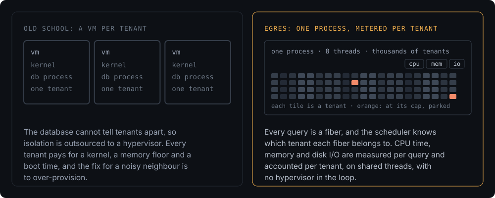

*Status: Mechanisms are built. Cap enforcement mid-query in future release.*

Egres is a single process, using a custom designed coroutine system called
zfiber. zfiber spawns as many threads as the number of logical cores, and
cooperatively schedules fibers across these threads. All work across the
database: connections, queries, WAL, compactions, disk and network I/O are run
using these fibers.

## Cpu Ticks and zfiber

zfiber is custom-built to the needs of a database. It is different from Go's
goroutines or Rust's Tokio in that it allows certain fibers to have higher
priority than others. For example, the fibers running raft loops get higher
priority and chosen over others if ready and waiting. zfiber also supports
dedicated lanes (a bunch of threads) for fibers which they can't cross. So a
very heavy query workload would not spill into the threads in the raft lane.

zfiber threads have local task queues. zfiber supports task stealing so no
thread sits idle while another has a queue. While zfiber doesn't natively evict
a running fiber, functions in Egres run a `maybeYield` call which can be used to
optionally yield a fiber. zfiber tracks CPU ticks spent per fiber so it can tell
how much CPU a query took.

<figure class="fig">
  
</figure>

## Direct I/O

Any disk activity causes a fiber to park and wait for the I/O completion,
meanwhile other fibers can run on the threads. zfiber uses Mitchell Hashimoto's
[libxev][] which provides io_uring on linux.

Egres does direct I/O, bypassing file system cache. All storage I/O activity
goes through a virtual filesystem API, which can meter the traffic to device and
throttle disk IOPS as needed. In fact, Egres runs a quick calibration on boot to
figure out each device's bandwidth, or it can be fed that bandwidth via command
line flags. It also calculates the cost of writes compared to the cost of reads,
so it can take those into account.

Inspired by the [SILK paper][silk], zdb uses 3 priorities for disk operations.
P0 is for queries, P1 for L0 flushes, and P2 for L1+ compactions. Knowing the
full bandwidth of the disk, zdb would throttle disk operations based on total
minus bandwidth used by higher priorities. Thus, compactions don't interfere
with queries and ensure query latencies stay low even with 8 compactors running
at the same time. The same mechanisms could be applied for requests to object
storage, albeit based on number of pending requests instead of bandwidth.

[libxev]: https://github.com/mitchellh/libxev
[silk]: https://www.usenix.org/conference/atc19/presentation/balmau

## Memory

Furthermore, all memory is allocated via custom allocator (wrapper over jemalloc
/ mimalloc) which Zig makes easy to support. As of this release, only the total
memory used by the process is being tracked. But in the future releases, it
would start tracking memory used per query and tenant. A memory allocation would
then allow a fiber to yield (wait for memory to be released by other fibers) or
if over-allocated, could be rejected with an error propagated all the way back
to the user, instead of crashing with OOM.

<figure class="fig">
  
</figure>

Given these mechanisms, Egres is able to accurately meter and throttle the
CPU ticks spent, the memory used, and the disk IOPS per query, per tenant. This
allows thousands of tenants to share resources, without causing any noisy
neighbor problem, and avoids the need to have thousands of VMs per Egres
process.

## MicroVMs

Neon and AlloyDB wrap each Postgres in a microVM for two reasons, which don't
directly apply to Egres. The first is security. Postgres has no boundary inside
the process: extensions are C running with the engine's full power, and a
memory-safety bug in that code, reached through one tenant's input,
reaches every tenant's data. A VM per tenant puts a kernel between them.

Egres is one process too, so what it does instead is shrink the attack surface.
A client can send only SQL, a session is bound to one database at connection
time (auth coming in future release), and no tenant native code runs in the
process. Extensions will be compiled into the engine rather than loaded at
runtime, and user-defined functions (likely WebAssembly), will run in a sandbox
metered like any other fiber. That is the bet every multi-tenant web service
makes: a small surface instead of a kernel per customer.

<figure class="fig">
  
</figure>

The second reason is best phrased by [AlloyDB][alloydb-arch]: "shared
allocations mean shared fate". Postgres's memory cannot be capped from outside,
so a cgroup limit means the OOM killer takes the postmaster down and every
tenant with it. In Egres, running out of a resource is a function error, which
can be treated like every other error and returned all the way back to the user.
Tenants share the resources but do not share the fate.

[alloydb-arch]: https://cloud.google.com/blog/products/databases/alloydbs-agentic-database-architecture
