*Status: available in the current release.*

zdb stores updates to the same row as versions. Each version carries its 64-bit
commit HLC timestamp, and a read at a timestamp returns the newest version at or
below it. Every read is a fixed snapshot over the entire database.

zdb does one interesting thing here. Other LSM trees write `(key, version ts)`
composite as the key, with one entry per version. zdb encodes the versions in
the value itself, keeping only one key per row. This reduces the number of keys
in the system by a factor, results in smaller SSTable block indexes and faster
key lookups.

## Garbage Collection

Every Egres node tracks the minimum read timestamp of transactions currently
running in the system, as Tlow. It is bound by a configurable maximum
transaction age so an idle transaction cannot pin it forever. When followers
reply to the leader's heartbeats, they include their Tlow.

When creating and proposing a snapshot, the leader picks a Raft index in the
past, which is either past a certain age `min_age_seconds`, or leaves a certain
WAL size `min_bytes`, while ensuring it is picking all writes still in the
memtable. For that Raft entry, it finds its HLC timestamp = Tindex.

Then the leader calculates the minimum across all of these, with Tsnap
= MIN(Tindex, Tlow for each node). When creating and
proposing a snapshot, the leader sets this Tsnap. Once applied, every
node in the cluster rejects reads below Tsnap. Note that because
every replica's open readers already counted towards the Tsnap, a
replica doesn't have to kill a running query to keep up (except one beyond its
max age).

All compactions can then drop unneeded versions below Tsnap, hence
garbage collecting them and freeing up space.

<figure class="fig">
  
</figure>

## Simple, Effective GC

Both Egres and Postgres keep old versions for as long as the slowest reader
needs them. Egres does cap how long a transaction can stay open, so one
forgotten session cannot pin versions forever. The difference is what happens
afterwards.

In Postgres the dead tuples become holes in heap and index pages: VACUUM marks
the space reusable, but the table stays at its high-water mark, with live rows
spread thin across pages, until VACUUM FULL or pg_repack rewrites it. Moreover,
Postgres has to vacuum even a table nobody writes to, to freeze its transaction
ids before the 32-bit counter does.

In Egres, when Tsnap moves forward, the dead versions vanish at the
next compaction of their files, and the live ones are rewritten into dense new
files with no holes. Garbage collection piggybacks on compactions, which are
much lighter than a VACUUM scan. Each compaction operates on a few files at a
time, releasing disk space as it goes. Timestamps are 64-bit, so there's no
counter to wrap. Egres never has a reason to visit a cold tree, and cold trees
skip compaction altogether.
