*Status: Raft and the hybrid logical clock are already present. Multi-node setup
would be tested and made available in the next release.*

Egres uses [Raft][raft] for replication, for scaling out reads and to survive
node failures with automatic failover. Each entry in the Raft log stores a
hybrid logical clock (HLC) timestamp assigned by the leader, so timestamps
increase monotonically. As a replica applies the log, it advances its own clock
to the entry's timestamp. That clock tells the replica how far behind the leader
it is, and which queries it can safely serve.

[raft]: https://raft.github.io/

In a multi-node cluster (next release), the node you connect to would own the
session. A write arriving at a follower would forward it to the leader, who
would commit it through Raft, and return the commit timestamp back to the
follower to store it in the session. Any future reads can then be served
directly from the follower. The follower would block the read until it has
applied the log corresponding to the commit timestamp (typically milliseconds),
thus achieving read your write guarantee.

<figure class="fig">
  
</figure>

zdb is well integrated with Raft replication. Instead of using its own
write-ahead log, it uses the Raft WAL. So, every replica sees the same updates
to its memtables and reads a write to the leader practically as soon as it
commits.

## Replicated Compactions For Object Storage

zdb also does something that's harder to find in open-source: **replicated
compactions.** With files on object storage, a compaction is broken into 2
stages. The first stage runs the compaction, generates the files, uploads them
to S3, and emits a manifest update for the leader to propose.

That update is optionally announced to the cluster first, so other nodes can
fetch chunks of the new files directly from S3 and warm them up before they are
needed. The leader then proposes the manifest update through Raft. The manifest
update is a delta: namespace id, tree id, minus these file ids at one level,
plus these file ids at the next. It does not contain the file data. Memtable
flushes go through the same process, so the log holds every change to zdb.

In the second stage, as the Raft log is applied, the manifest update is applied
to zdb in the same order, resulting in an identical zdb forest across all
replicas. Even the replicas which didn't run the compaction get the compacted
forest.

<figure class="fig">
  
</figure>

This removes the need for every replica to run its own background compactions,
saving CPU and disk I/O. It also means the data lives once on S3, shared by
every replica, instead of each replica holding its own slightly different
version, N times for N replicas. The leader can also hand compaction work to any
node in the cluster to spread the load, saving its own resources, which are the
most precious in the cluster.

Replicated compactions also make bringing up a new replica on object storage
cheap and fast. The manifest is rebuilt from the WAL: fetch the last snapshot
manifest, apply the manifest updates since, then replay only the writes still in
memtables and not yet flushed, recreating the memtables. This yields an
identical zdb forest as all others, which also makes query latencies
predictable.
