*Status: available in the current release.*

## ZDB: LSM Forest

Egres runs on top of a new storage engine called [zdb][]. While zdb bootstrapped
as a port of [Badger][] from Go to Zig, it quickly went way beyond Badger. zdb is
a tree of LSM trees, aka an LSM forest, integrates heavily with [Raft][raft]
consensus and reuses the Raft write-ahead log instead of having its own.

[zdb]: https://github.com/manishrjain/egres/tree/main/zdb
[Badger]: https://github.com/dgraph-io/badger
[raft]: https://raft.github.io/

zdb mirrors the Postgres hierarchy. It has namespaces, which map to Postgres
databases. Each namespace owns many zdb tables. Each SQL table, and each of its
indexes, gets its own zdb table. Every zdb table is one or more LSM trees. The
benefit of this hierarchy is that zdb can branch or drop a namespace, table or
index instantly (see [branching](branching.md)). Moreover, heavy writes to one
table do not cause compaction pressure in another.

<figure class="fig">
  
</figure>

## Shared Memtables

An Egres instance which has hundreds of tables would have hundreds of LSM trees.
A typical LSM tree would have in-memory tables, called memtables, and having
memtables per tree would cause excessive memory usage.

To avoid that, zdb shares the same memtables across all namespaces, with keys
prefixed with `(ns, table id)`. SSTables are owned by the tree; the `(ns, table
id)` can be inferred, so SSTables don't store that prefix. The SSTable iterator
sets the `(ns, table id)` prefix to the keys it outputs during iteration, thus
allowing accurate key comparisons across tables and namespaces.

## Tree Splits

Each table starts with one LSM tree, but as tree size grows (> 10 GiB), zdb can
split it in half to keep the compactions running predictably. Because each
tree's size is bounded, zdb only uses 4 levels (Level 0 to Level 3) per tree.
Thus, each table can own many trees. Both the size and levels per tree are
configurable.

Tree splits don't cause any data movement. zdb finds a median key which would
split the sizes as equally as possible based on the files in the last level, and
assigns SSTable files to each side. The files which overlap are assigned to
both. Later compactions only iterate over each tree's assigned key range. Once
split, trees can run compactions independently and concurrently. Moreover, a
tree whose key range doesn't get updates can avoid compactions entirely.

<figure class="fig">
  
</figure>

## Compression and Checksum

zdb does block level compression, using the faster lz4 compression for L0 and L1
files, and the slightly slower but more powerful zstd for L2 and L3. On the
[benchmarks](../benchmarks.md), Egres took about half the disk Postgres did, the
same kind of saving that [MyRocks][fb-myrocks] brought to MySQL. Of course,
savings from compression depend a lot on the kind of data being stored, so YMMV.

Every block carries a checksum, which is verified on every read, so a corrupt
block is caught before it's served. In the future, these blocks can also be
encrypted to provide encryption at rest.

[fb-myrocks]: https://research.facebook.com/publications/myrocks-lsm-tree-database-storage-engine-serving-facebooks-social-graph/

## Local Disk Or Object Storage

zdb runs on local disk, or on object storage using S3 APIs. This allows Egres to
achieve a blazing fast NVMe experience with local storage. Or, a serverless
experience with remote object storage providing compute storage separation. When
using object storage, zdb uses a disk cache to store fixed-size file chunks on
local disk (if available), reducing S3 API calls and the associated latency.
This disk cache is in addition to the in-memory cache that zdb already uses to
store SSTable blocks across both storage mediums.

In fact, zdb internally uses a simple interface for file access, which can be
extended to other technologies like Azure Blob Store or Google Cloud Storage
APIs, or HDFS, etc.

<figure class="fig">
  
</figure>

## Remote Data, Local WAL

Even when SSTables live on object storage, the WAL stays on local disk. A
write is deemed committed when its WAL entry is durable, so WAL latency dictates
commit latency. Only local disk delivers that at low latency; S3 does not. The
WAL only needs a few gigabytes, which is cheap on local NVMe, so Egres keeps it
there.

The cost is that an Egres node is not fully stateless: a replacement node gets
the WAL from its Raft peers. That is fine here. One Egres node serves thousands
of tenants and doesn't need to scale to zero when some of them go idle, so
there's no need to move the WAL off the node to make compute disposable.
