*Status: available in the current release.*

Egres provides Snapshot Isolation, the same as Postgres' repeatable read
isolation. Serializable isolation is planned for future releases.

In Egres, write transactions run on the leader. At BEGIN, the transaction
assigns leader's last applied timestamp as the read timestamp,
Tread. From then on, every read gets a fixed snapshot of the
database as of Tread. Reads do not block and do not acquire any locks,
unless `FOR UPDATE`.

## Deadlock Detection

<figure class="fig">
  
</figure>

Writes use pessimistic locking. A write statement first gathers all the rows it
would change, then locks them in key order to avoid cycles. Locking is done via
[SemaphoreMap][] which exists only in leader's memory. In addition to holding
locks, the map maintains a wait-for graph and detects any deadlocks at the time
of lock acquisition. In case it finds a deadlock cycle, the transaction is
immediately aborted and all held locks are released. There are no lock timeouts.

[SemaphoreMap]: https://github.com/manishrjain/egres/blob/main/zfiber/semaphore_map.zig

## Conflict Detection

The leader also keeps an in-memory [Oracle][oracle]: a map from row hash to its
latest commit timestamp. After locks are acquired, their hashes are checked
against the Oracle to find the max commit timestamp among them,
Tmax_commit. If Tmax_commit is at or below
Tread, nobody else changed them and the statement proceeds.

[oracle]: https://github.com/manishrjain/egres/blob/main/sql/oracle.zig

If Tmax_commit is higher than Tread, the rows are stale.
Egres bumps up the Tread to Tmax_commit and re-runs the
single statement; already acquired locks stay held.

A multi-statement transaction first checks if the earlier statements' row hashes
have Tmax_commit above Tread. If not, it executes the same
way as above, updating Tread to Tmax_commit and re-running
the current statement. Otherwise, it fails the transaction with 40001, the same
serialization failure Postgres returns.

<figure class="fig">
  
</figure>

All of a transaction's row and index writes go into a memtable owned by that
transaction. When reading, this memtable is overlaid on zdb, so the transaction
can see its own pending writes. Nothing touches storage or the Raft log until
COMMIT, which proposes the entire write set, applied atomically on every
replica. There is no validation phase at commit, because every conflict was
settled by the locking described above before the statement wrote anything.

Pessimistic locking was chosen over optimistic on purpose. Dgraph had optimistic
locking which caused abort storms under high contention. N transactions would
race for a hot key, one wins, and N-1 waste all their work and have to re-do it.
Pessimistic locking turns that contention into a queue, while disjoint
transactions still run in parallel. Locks are taken on rows and unique index
keys only. Non-unique index updates to the same index key run concurrently.
